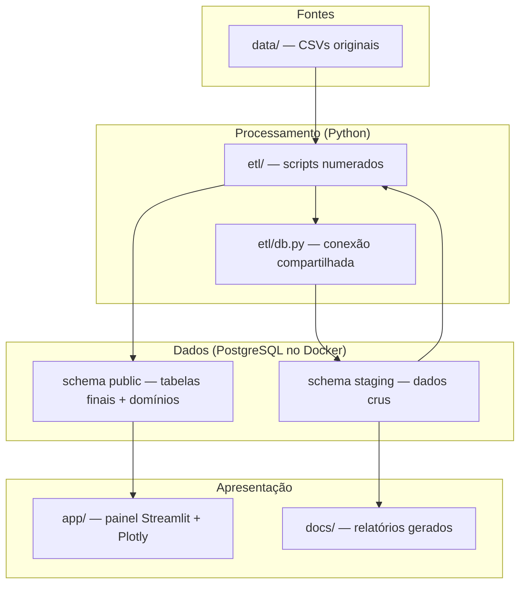
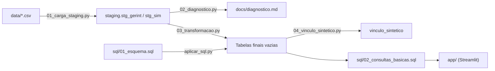

# Arquitetura e convenções do projeto

Projeto de banco de dados que integra duas bases de saúde de Porto Alegre: **GERINT** (solicitações de internação) e **SIM** (óbitos).

## 1. Modelo arquitetural

**Classificação: pipeline ETL em lote, com banco de dados central (arquitetura em duas camadas lógicas de dados, aplicação em um único repositório).**

| Termo | Cabe aqui? | Justificativa |
|---|---|---|
| **Monolítica** | Parcialmente | Há um único repositório e um único banco. Mas não é um servidor de aplicação único: os scripts rodam sozinhos, em lote, um de cada vez. |
| **Microsserviços** | Não | Não há serviços independentes se comunicando por rede. |
| **Em camadas (N-tier)** | Só de forma leve | Há separação entre dados, processamento e apresentação, mas sem a formalidade (controllers, services, repositories) que o escopo pequeno não justifica. |
| **Pipeline ETL** | **Sim, é o modelo principal** | Os dados fluem em etapas: extrair (CSV), transformar (limpeza) e carregar (esquema final). |
| **Cliente-servidor** | Sim | O PostgreSQL (servidor, no Docker) atende os scripts Python e o painel (clientes). |

### Camadas lógicas



- **Fontes:** `data/`, apenas leitura.
- **Dados:** o PostgreSQL guarda tudo. O schema `staging` tem a cópia crua dos CSVs; o `public` tem o modelo final.
- **Processamento:** scripts Python em lote, que leem, limpam e gravam.
- **Apresentação:** painel Streamlit (consultas e gráficos) e relatórios em Markdown.

## 2. Como Python e SQL se combinam

Os dois não são concorrentes: cada um faz o que faz melhor.

- **SQL** descreve a estrutura e as consultas. É executado **dentro do PostgreSQL**.
- **Python** lê arquivos, aplica lógica e **envia comandos SQL ao banco**.

Esse padrão se chama **SQL embutido** (*embedded SQL*) ou **acesso a dados via driver**: o código Python monta/chama comandos SQL e o banco os executa. Ele aparece de três formas no projeto:

| Forma | Onde | Exemplo |
|---|---|---|
| Executar um arquivo `.sql` inteiro | `etl/aplicar_sql.py` | Lê `sql/01_esquema.sql` e o envia ao banco |
| Comandos SQL escritos no código | `etl/01_carga_staging.py` | `CREATE SCHEMA ...`, `SELECT COUNT(*) ...` |
| Pandas/SQLAlchemy gerando o SQL | `etl/01_carga_staging.py`, `02_diagnostico.py` | `df.to_sql(...)`, `pd.read_sql("SELECT ...")` |

A pilha de acesso ao banco é: **script Python → SQLAlchemy → psycopg2 (driver) → PostgreSQL**.

> [!IMPORTANT]
> **Cuidado com o termo "injeção SQL".** Ele nomeia um *ataque de segurança*, em que um usuário malicioso insere SQL numa entrada de texto. O que fazemos é outra coisa: é **SQL embutido**, uma prática normal e legítima. Num relatório, use "SQL embutido" ou "acesso ao banco via Python". Dica de segurança: quando o painel receber filtros digitados pelo usuário, passe os valores como **parâmetros** (`text("... WHERE x = :valor")`) em vez de concatenar texto.

## 3. Organização em etapas (pipeline)



| Etapa | Arquivo | Estado |
|---|---|---|
| 1. Carga bruta (staging) | `etl/01_carga_staging.py` | Pronto |
| 2. Diagnóstico de qualidade | `etl/02_diagnostico.py` | Pronto |
| 3. Esquema final | `sql/01_esquema.sql` + `etl/aplicar_sql.py` | Pronto (branch `esquema-sql`) |
| 4. Transformação e carga final | `etl/03_transformacao.py` | A fazer (tarefa B) |
| 5. Consultas básicas | `sql/02_consultas_basicas.sql` | A fazer (tarefa C) |
| 6. Painel v1 | `app/main.py` | A fazer (tarefa C) |
| 7. Vínculo sintético (experimental) | `etl/04_vinculo_sintetico.py` | Depois da entrega parcial |

## 4. Glossário

- **ETL:** Extract, Transform, Load (extrair, transformar, carregar).
- **Staging:** área intermediária com a cópia fiel dos dados de origem, tudo como texto, sem correções. Permite refazer a limpeza sem reler os arquivos.
- **Esquema (schema):** "gaveta" dentro do banco que agrupa tabelas. Aqui, `staging` e `public`.
- **PK / FK:** chave primária (identifica a linha) / chave estrangeira (liga uma tabela a outra).
- **Tabela de domínio (`dom_*`):** lista de valores permitidos, usada como FK para impedir valores inválidos.
- **CHECK:** regra de validação de uma coluna (ex.: idade entre 0 e 120).
- **Diagnóstico (profiling):** medição da qualidade dos dados antes da limpeza.
- **Vínculo sintético:** ligação artificial entre GERINT e SIM, já que não há ID em comum. É sempre rotulada como experimental.

## 5. Convenção de pastas e arquivos

| Pasta / arquivo | Conteúdo | Regra |
|---|---|---|
| `data/` | CSVs originais | Nunca editar à mão |
| `etl/` | Scripts Python do pipeline | Numerados na ordem de execução (`01_`, `02_`, ...); `db.py` é a conexão compartilhada |
| `sql/` | Scripts SQL | Também numerados (`01_esquema.sql`, `02_consultas_basicas.sql`) |
| `app/` | Painel Streamlit | `main.py` e as páginas |
| `docs/` | Documentação | `diagnostico.md` é gerado pelo script; não editar à mão |
| `.env` | Credenciais do banco | Fora do git; `.env.example` é o modelo |
| `docker-compose.yml` | Sobe o PostgreSQL 16 | Porta 5433, banco `saude_poa` |

**Regras gerais**
- Scripts podem ser rodados várias vezes sem estragar nada (idempotentes): o esquema apaga e recria as tabelas finais, e a carga bruta substitui o staging.
- Nomes de tabelas e colunas: minúsculas, sem acentos nem espaços, exatamente como no plano combinado.
- Os identificadores originais são preservados em `id_origem`; nunca sobrescrever dados originais.
- Valores derivados ficam em colunas separadas (ex.: `horas_na_fila_original` e `dias_ate_autorizacao`).

## 6. Fluxo de trabalho no git

- Uma branch por pessoa: `esquema-sql` (A), `etl-transformacao` (B), `consultas-painel` (C).
- `git pull` antes de começar e `git push` ao terminar cada bloco.
- Não versionar `.env`, `.venv/` nem `__pycache__/`.

## 7. Como executar

```powershell
# com o ambiente virtual ativo (ou use .venv\Scripts\python.exe)
docker compose up -d
python etl/01_carga_staging.py
python etl/02_diagnostico.py
python etl/aplicar_sql.py sql/01_esquema.sql
```
